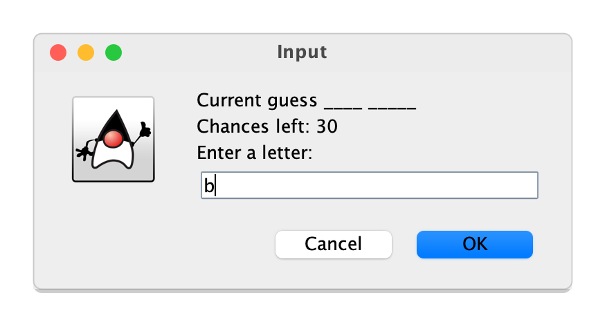
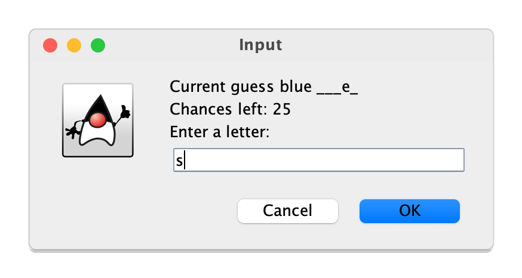
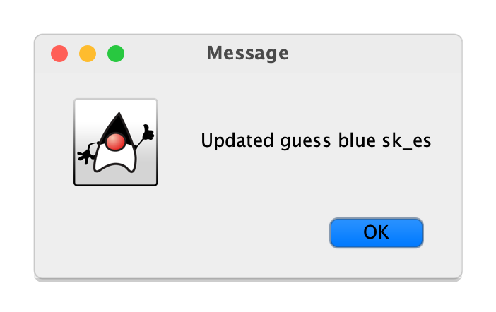
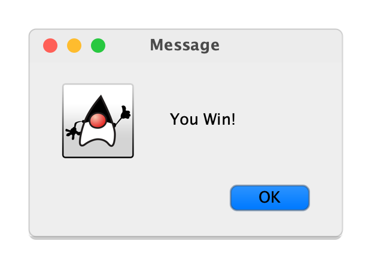
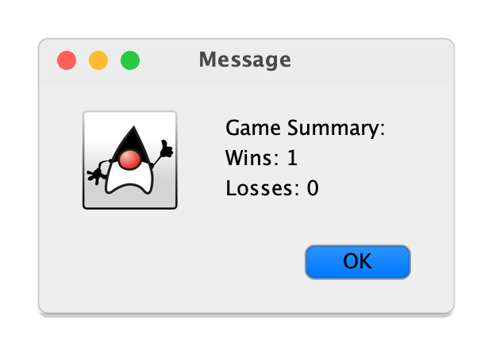

# hangman-game-java
A Hangman game in Java with a pop-up dialog interface (Swing `JOptionPane`). The program picks a random secret phrase, and you guess one letter at a time to reveal it before your chances run out. Wins and losses are tallied across rounds.

## Screenshots

| New game | Guessing a letter |
|---|---|
|  |  |

| Letter revealed | You win |
|---|---|
|  |  |

After you decline another round, the game shows your record:



## How it works
- `Hangman` (domain class) holds the secret phrase and the player's progress. The constructor picks a random phrase and builds the blank pattern, keeping spaces visible.
- `PlayGame` (driver) runs the rounds in a do-while loop: `processGuesses` reveals every occurrence of each guessed letter, `determineWinner` scores the round, and `summarize` shows the totals.

## Run it
Requires Java 17+.
```
javac -d out Hangman.java PlayGame.java
java -cp out Hangman.PlayGame
```
